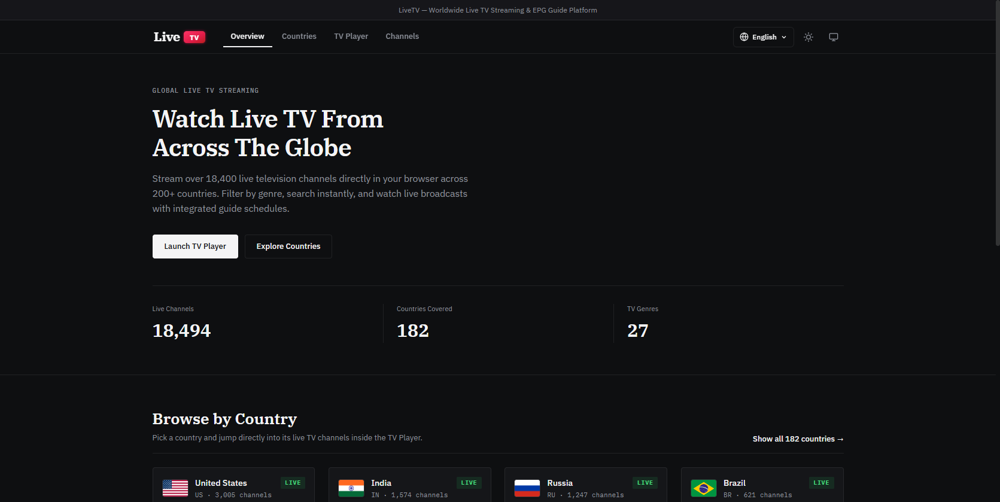
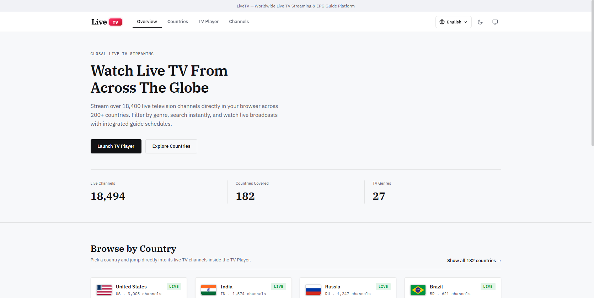
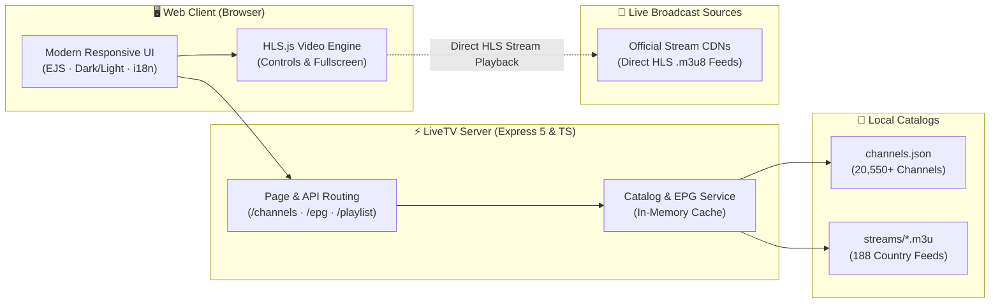

<p align="center">
  <a href="https://github.com/shakibzcv/live-tv">
    
  </a>
</p>

<p align="center">
  <strong>Worldwide Live TV Streaming Platform & Web Player</strong><br>
  Watch 20,550+ free live TV channels from 250 countries and territories directly in your browser with fast HLS streaming, M3U playlists, and integrated guide schedules.
</p>

<p align="center">
  <a href="https://github.com/shakibzcv/live-tv/blob/main/LICENSE"></a>
  <a href="https://nodejs.org/"></a>
  <a href="https://www.typescriptlang.org/"></a>
  <a href="https://expressjs.com/"></a>
  <a href="https://github.com/video-dev/hls.js"></a>
  <a href="#-key-features"></a>
  <a href="#-key-features"></a>
</p>

---

## 📖 Overview

**LiveTV** is a modern, high-performance live television streaming platform and browser-based web player. Watch 20,550+ free live TV channels from 250 countries and territories directly in your browser with fast HLS streaming, M3U playlists, and integrated guide schedules. It provides instant access to **20,550+ free-to-air live television streams from 250 countries and territories (188 active streaming nations)**, fully categorized by country, genre, and broadcast resolution.

Featuring a native HLS streaming player, custom audio and display controls, country-specific M3U playlists, XMLTV/Rytec feeds, multi-language internationalization (i18n) with RTL support, and a dual-theme dark/light UI, LiveTV is designed for desktop, tablet, and mobile viewing.

---

## 📸 App Preview

<p align="center">
  
  &nbsp;
  
</p>
<p align="center">
  <em>LiveTV Web Player & Channels Directory in Matte Dark and Clean Light Themes</em>
</p>

---

## 🌟 Key Features

- 📺 **Global Live TV Directory**: Browse and search over 20,550+ television channels indexed by country, category (News, Sports, Movies, Animation, Music, Documentaries, General), and stream resolution (HD/SD).
- ⚡ **Interactive In-Browser Player**: Low-latency live video streaming powered by [HLS.js](https://github.com/video-dev/hls.js) with native fallback for Safari (iOS & macOS).
- 🎛️ **Custom Player Controls**: Smooth volume slider with mute toggle, stream reload, fullscreen toggle, Picture-in-Picture (PiP), Closed Captions (CC), and quick stream URL sharing.
- 🗺️ **250 Country M3U Playlists (188 Active)**: Every country has an organized playlist in `streams/<country_code>.m3u` and dynamic API export (`/api/playlist/:code.m3u`).
- 📅 **Integrated Guide Schedules**: Channel-level broadcast schedules and live "Now Playing" program guide rendered in real time directly inside the TV player on supported channels.
- 🌗 **Light & Dark Mode**: Sleek default matte dark theme (`#0e0f11`) with a ruby accent (`#e11d48`) alongside a crisp light mode. State is persisted in `localStorage` with zero-flash booting.
- 🌐 **Multilingual & RTL Support**: Built-in instant language switcher supporting 8+ languages: English, Spanish, German, French, Arabic (with native RTL layout), Russian, Turkish, Hindi, and Bengali.
- 📱 **Fully Responsive UI**: Mobile-first design engineered with CSS grid and flexbox, adapting effortlessly across smartphones (320px+), tablets, laptops, and ultra-wide 4K screens.
- 🛡️ **Clean & Modular**: Streamlined TypeScript architecture with minimal runtime dependencies.

---

## 🛠️ Architecture & How It Works



### Tech Stack Breakdown

- **Backend**: [Node.js](https://nodejs.org/), [Express 5](https://expressjs.com/), [TypeScript](https://www.typescriptlang.org/)
- **Templating**: [EJS](https://ejs.co/) (Embedded JavaScript templates)
- **Streaming Engine**: [HLS.js](https://github.com/video-dev/hls.js) (HTTP Live Streaming)
- **Styling**: Modern CSS3 (Custom properties, CSS Grid, Flexbox, media queries)
- **Typography**: [IBM Plex Sans](https://fonts.google.com/specimen/IBM+Plex+Sans), [IBM Plex Serif](https://fonts.google.com/specimen/IBM+Plex+Serif), [IBM Plex Mono](https://fonts.google.com/specimen/IBM+Plex+Mono)
- **Logging**: [Winston](https://github.com/winstonjs/winston) & [Morgan](https://github.com/expressjs/morgan)
- **Compression & Security**: [compression](https://www.npmjs.com/package/compression), [cors](https://www.npmjs.com/package/cors), [dotenv](https://www.npmjs.com/package/dotenv)

---

## 🚀 Getting Started

### Prerequisites

- [Node.js](https://nodejs.org/) (version `18.0.0` or higher recommended)
- [pnpm](https://pnpm.io/) (or `npm` / `yarn`)

### Installation

1. **Clone the repository**:
   ```bash
   git clone https://github.com/shakibzcv/live-tv.git
   cd live-tv
   ```

2. **Install dependencies**:
   ```bash
   pnpm install
   ```

3. **Set up environment variables** (optional):
   ```bash
   cp .env.example .env
   ```
   *Default port is `3000`.*

### Running the App

- **Development Mode** (with automatic TypeScript compilation and hot-reload):
  ```bash
  pnpm dev
  ```

- **Production Build & Start**:
  ```bash
  pnpm build
  pnpm start
  ```

Once running, navigate to `http://localhost:3000` in your web browser.

---

## ⌨️ Player Keyboard Shortcuts

When in the TV Player view:

| Shortcut | Action |
|:---|:---|
| <kbd>M</kbd> | Toggle Mute / Unmute audio |
| <kbd>F</kbd> | Toggle Fullscreen mode |
| <kbd>Enter</kbd> (in channel search) | Instantly play the first matching channel |
| <kbd>Escape</kbd> | Close any open modal dialog |

---

## 📁 Directory Structure

```text
live-tv/
├── api/                    # Serverless entrypoint (e.g., Vercel deployment)
│   └── index.ts
├── data/                   # Channel and country databases
│   ├── channels.json       # Master channel registry (20,550+ streams)
│   └── countries.json      # Country metadata, flags, and codes
├── public/                 # Static web assets
│   ├── css/
│   │   └── style.css       # Responsive design & theme variables
│   ├── js/
│   │   ├── app.js          # Core client-side player & UI controller
│   │   └── i18n.js         # Multi-language translations dictionary
│   ├── favicon.svg         # Square ruby TV badge favicon
│   └── logo.svg            # Official vector logo lockup
├── src/                    # TypeScript backend source code
│   ├── logger/             # Winston & Morgan logging setup
│   ├── middlewares/        # Express error handlers & middlewares
│   ├── routes/             # API routes definition
│   ├── services/           # Data indexing, EPG, & verifier services
│   ├── utils/              # ApiResponse, ApiError, & async wrappers
│   ├── app.ts              # Express application configuration
│   ├── env.ts              # Environment configuration
│   ├── index.ts            # HTTP server entrypoint
│   └── types.ts            # TypeScript interfaces and types
├── streams/                # Consolidated country M3U playlists
│   ├── us.m3u
│   ├── uk.m3u
│   ├── bd.m3u
│   └── ... (188 country files)
├── views/                  # EJS page templates
│   └── index.ejs           # Single-page UI template
├── CONTRIBUTING.md         # Contribution guidelines
├── CODE_OF_CONDUCT.md      # Contributor Covenant Code of Conduct
├── LICENSE                 # MIT License
├── package.json            # Project manifest & scripts
├── tsconfig.json           # TypeScript configuration
└── README.md               # Project documentation
```

---

## 🤝 Contributing

We welcome contributions from developers and stream maintainers worldwide! Whether adding newly available legal streams, fixing broken links, improving EPG data, or expanding translations:

1. Read our [CONTRIBUTING.md](CONTRIBUTING.md) guide for guidelines on stream formats, code standards, and PR workflows.
2. Please make sure to follow our [CODE_OF_CONDUCT.md](CODE_OF_CONDUCT.md) in all community interactions.

---

## 📜 Code of Conduct

To maintain an open, welcoming, and harassment-free environment, LiveTV adheres to the [Contributor Covenant](CODE_OF_CONDUCT.md). Please report any unacceptable behavior to [shakibzcv@gmail.com](mailto:shakibzcv@gmail.com).

---

## 📬 Contact & Support

If you have questions, feedback, stream suggestions, or need help integrating LiveTV:

- **Project Maintainer**: Shakib Khan
- **Email**: [shakibzcv@gmail.com](mailto:shakibzcv@gmail.com)
- **GitHub Repository**: [https://github.com/shakibzcv/live-tv](https://github.com/shakibzcv/live-tv)
- **Issue Tracker**: [https://github.com/shakibzcv/live-tv/issues](https://github.com/shakibzcv/live-tv/issues)

---

## ⚖️ License

This project is licensed under the **MIT License** — see the [LICENSE](LICENSE) file for complete details.
